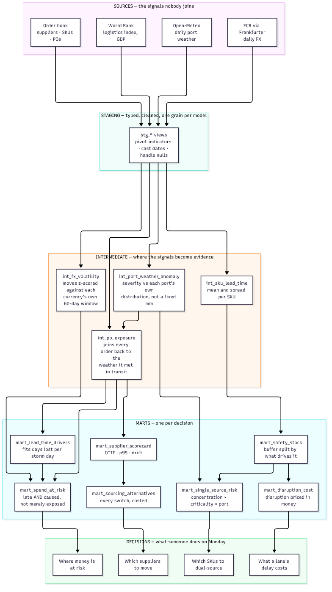

# Sourcing Control Tower


An analytics warehouse that answers one question a procurement team cannot
answer from its ERP: **which sourcing lanes are quietly costing us money, and
what should we do about them this week?**

Three live public feeds supply the external risk picture. A simulated order book
supplies the business grain. dbt turns both into decision marts, and a Streamlit
app ranks the actions worth taking.

```
653M USD order book  ·  48 suppliers  ·  10 countries  ·  9,000 purchase orders
```

---

## Contents

- [The problem](#the-problem)
- [Architecture](#architecture)
- [How the architecture solves it](#how-the-architecture-solves-it)
- [Results](#results)
- [Running it](#running-it)
- [What is real and what is simulated](#what-is-real-and-what-is-simulated)
- [Engineering](#engineering)
- [Limitations](#limitations)

---

## The problem

A pharmaceutical buyer sources ten countries through ten ports. Their ERP knows
what was ordered and when it arrived. It does not know **why** anything was
late, and it cannot price what lateness cost.

So three questions go unanswered every quarter:

**"Why did this lane slip?"** The ERP records a delay. It does not record the
storm that closed the origin port while the container sat waiting. Nobody joins
weather to purchase orders, so delay looks like supplier incompetence when it is
often geography.

**"What did the disruption actually cost?"** Teams report delay in days. Days are
not money. The real cost is the air freight paid to rescue a critical line, plus
the extra stock held all year because a lead time cannot be trusted — and neither
figure appears anywhere.

**"Which items should we fix first?"** Spend reports rank by value, so the
biggest line items get the attention. But a 40,000 USD API with one qualified
supplier behind a storm-prone port is a far bigger risk than a 4M USD item with
four alternatives. Severity and spend are different things.

The underlying cause is that each signal lives in a different system and nobody
joins them. Weather sits with the forwarder, FX with treasury, logistics indices
in a World Bank report, and orders in the ERP. Individually each one is noise.
Joined on country and date, they explain the delay.

**This project exists to do that join and act on it.**

---

## Architecture



*Diagram source: [`docs/architecture.mmd`](docs/architecture.mmd)*

The shape matters more than the box count. **Staging** only cleans. **Intermediate**
is where raw signals become evidence — a storm becomes an anomaly relative to its
own port, a currency move becomes a z-score, an order gains the weather it met.
**Marts** each answer one question, and the dashboard renders decisions rather
than charts.

---

## How the architecture solves it

### 1. The join nobody does

`int_po_exposure` joins every purchase order back to the weather at its origin
port across the days it was meant to be in transit. This is the move the ERP
cannot make, and everything downstream depends on it.

Critically, **the storm count is never supplied by the source data.** The order
book records dates, quantities and prices — nothing about weather. The warehouse
derives the exposure itself, which is what lets `mart_lead_time_drivers` fit the
relationship rather than assert it:

```
2.04 delivery days lost per anomalous port day   (R² 0.965)
```

| storm days in transit | orders | mean delay vs promise |
|---|---|---|
| 0 | 1,403 | −5.1 days (early) |
| 1 | 2,490 | −3.0 days |
| 2 | 2,326 | +0.3 days |
| 3 | 1,064 | +3.0 days |
| 4 | 741 | +5.1 days |
| 5 | 426 | +7.1 days |

Clean lanes land early because suppliers quote with a buffer. Each storm day eats
roughly two days of that buffer until it is gone.

### 2. Thresholds replaced with statistics

A fixed 50mm cut-off treats Hamburg and Nhava Sheva as the same port. They are
not. `int_port_weather_anomaly` scores each day against **that port's own
distribution** and flags the 97th percentile. The same logic applies to currency:
`int_fx_volatility` z-scores every move against that currency's own 60-day
volatility, because a 1% day is noise for BRL and a shock for EUR.

### 3. "At risk" defined narrowly enough to be useful

Nearly every long-haul order touches some bad weather. Counting any storm day
flags ~88% of spend and tells nobody anything. `mart_spend_at_risk` defines
exposure as an order that **slipped more than seven days late AND had an
anomalous port day in transit** — late, with a cause. That lands at a fraction of
spend small enough to work through.

### 4. Cost in money, not days

`mart_disruption_cost` prices two things that are both observable in the book:

- **Air freight actually paid** to rescue critical lines that started slipping
- **Carrying cost of the buffer** held only because lead times are unreliable

### 5. ABC classification that does something

Criticality is not a label here. It drives behaviour in three places: A lines get
expedited by air when they slip, A items are held to a 99% service level against
C's 90%, and concentration risk is weighted by it. The effect is visible in the
data — A items run 10 points better on OTIF than B, and they cost real money to
keep there.

| criticality | orders | OTIF | shipped by air | air freight paid |
|---|---|---|---|---|
| A | 1,594 | 64.1% | 22.8% | $1.71M |
| B | 4,451 | 53.7% | 0% | — |
| C | 2,955 | 55.1% | 0% | — |

### 6. Safety stock that names its own cause

Buffer is sized against demand **and** lead-time variability together:

```
SS = Z × √( L · σ²demand  +  demand² · σ²lead )
```

The second term is the one most inventory policies ignore, and
`pct_buffer_from_lead_time` reports exactly how much of each buffer it explains.

---

## Results

> Figures below come from one build of the committed configuration. The offline
> generator is seeded but anchors its window to the current date, so a fresh run
> shifts them by a few percent. The relationships hold; the decimals move.

**Disruption costs this buyer $6.93M a year — 1.06% of total spend.** $1.71M of
that is air freight already paid; the rest is the annual carrying cost of stock
held against unreliable lead times.

**69% of the $14.8M tied up in safety stock exists because lead times move, not
because demand does.** That reframes the problem: it is not an inventory policy
failure, it is a supplier reliability failure, and buying more stock treats the
symptom.

**Cost concentrates in two lanes.** Shanghai and Nhava Sheva together carry over
half the disruption cost, and Shanghai's 1.24% of spend is the worst ratio on the
book.

| country | port | orders | spend | disruption cost | % of spend |
|---|---|---|---|---|---|
| CHN | Shanghai | 2,938 | $216.0M | $2.67M | 1.24% |
| IND | Nhava Sheva | 1,950 | $140.6M | $1.22M | 0.86% |
| USA | Los Angeles | 927 | $68.0M | $0.60M | 0.88% |
| MEX | Manzanillo | 646 | $47.6M | $0.55M | 1.15% |
| BRA | Santos | 677 | $48.4M | $0.43M | 0.88% |

**Ten critical SKUs sit on a single qualified supplier**, ranked by a severity
score that multiplies concentration, criticality and port risk — a working list,
not a wall of flags.

**The weight debate is settled in the open.** The country score keeps each
penalty as its own column, so the dashboard renders a waterfall from the
logistics index through weather, currency and delay. A simulator re-scores the
same components at whatever weights the viewer picks and shows which countries
change rank. Nobody has to accept a number they cannot argue with.

---

## Running it

```bash
pip install -r requirements.txt

python fetch.py            # live APIs + generated order book
python load.py             # raw CSV -> DuckDB
dbt build --profiles-dir . # build and test the warehouse
streamlit run dashboard/app.py
```

Or with the Makefile:

```bash
make install
make offline   # generate everything locally, no network at all
make build
make test      # 56 dbt tests + 8 python unit tests
make app
```

With Docker:

```bash
docker build -t sourcing-tower .
docker run -p 8501:8501 sourcing-tower
```

**One thing to know.** `fct_purchase_orders` is incremental and only reloads a
trailing 60-day window, which is correct for a real book where receipts get
corrected after the fact. The generator recycles PO ids, so after regenerating
data you must pass `--full-refresh`:

```bash
dbt build --profiles-dir . --full-refresh
```

Without it, rows outside the window keep values from the previous run. Row counts
and uniqueness tests still pass while the totals are wrong. This cost an hour to
find the first time.

### The dashboard

Seven tabs, each built around a decision rather than a chart type:

| Tab | Answers |
|---|---|
| Exposure | Which lanes are running late with a weather cause, and how much money sits behind them |
| What drives delay | The fitted storm-to-delay relationship, and a waterfall of why each country scores where it does |
| Inventory risk | How much buffer exists because of the supplier rather than the market; single-source critical items |
| Cost of disruption | Air freight and carrying cost, by country |
| Weight simulator | Re-score countries at your own weights and watch the ranking move |
| Suppliers | Service level against spend, with a deteriorating/stable/improving trend flag |
| Switch analysis | Every alternative supplier for every SKU, with price, OTIF and days-saved deltas |

---

## What is real and what is simulated

| Layer | Source | Real? |
|---|---|---|
| Logistics Performance Index, GDP, imports | World Bank API | real |
| Daily FX vs USD | Frankfurter (ECB reference rates) | real |
| Daily port weather | Open-Meteo archive | real |
| Suppliers, SKUs, purchase orders, demand | `ingest/supply_book.py` | **simulated** |

The buyer does not exist. This is stated in the app's sidebar as well as here.

What makes the simulation worth analysing is that the generator **reads the real
weather extract** and lets genuine storms at a supplier's origin port extend that
order's lead time — then deliberately does not write the storm count to its
output. The warehouse rediscovers the relationship by joining orders back to
weather.

The generator injects 2.8 days per storm day. The warehouse measures 2.04. The
gap is the point: the percentile detector is an imperfect proxy for the storms
that actually caused the delay, so the measured coefficient sits below ground
truth. A model that recovered 2.8 exactly would mean the answer had leaked into
the inputs.

---

## Engineering

```bash
make lint   # ruff over python, sqlfluff over the models
make docs   # lineage site into target/
```

**CI runs the whole pipeline on every push** — lint, unit tests, a full warehouse
rebuild, a headless render of the dashboard, and a docs build. It runs against
the offline fixtures, so there are no keys to manage and nothing flaky to retry.

**`fct_purchase_orders` is under an enforced dbt contract.** Every column's type
is declared and `on_schema_change: fail` stops an incremental run that would
quietly drift. Changing a column type fails the build, not the dashboard.

**The dashboard is a declared dbt exposure**, so
`dbt ls --select +exposure:sourcing_control_tower` answers "what does this chart
depend on" from the lineage graph instead of from memory.

**Two singular tests guard the analysis itself**, not just the data. One fails the
build if the storm-to-delay slope goes flat or its R² drops below 0.5; the other
if any safety stock comes out non-positive. A pipeline that silently stops
measuring the thing it was built to measure is worse than one that breaks.

**Python is unit tested, not only the SQL.** The tests assert the invariants the
generator must hold — orders never arrive before they are placed, only A lines
get expedited, orders sit inside the weather window, and the storm signal
survives into the book. One exists specifically because the offline and live
extracts can silently diverge if someone edits one and not the other.

**A smoke test renders the dashboard headlessly in CI**, catching the break a dbt
test cannot: a renamed mart column the warehouse is perfectly happy with and the
app is not.

### Layout

```
config.yml                countries, ports, currencies - the single source of truth
ingest/                   one module per feed, plus the order book simulator
load.py                   raw CSV -> DuckDB raw schema
models/staging/           typing, pivoting, null handling
models/intermediate/      weather anomalies, FX volatility, PO storm exposure,
                          per-SKU lead-time statistics
models/marts/             facts, dimensions and seven decision marts
models/exposures.yml      the dashboard, declared in the lineage graph
snapshots/                SCD-2 on supplier attributes
tests/                    singular tests on the analytical relationships
tests/unit/               pytest over the ingest layer
scripts/                  headless dashboard smoke test used by CI
dashboard/                Streamlit app + chart theme
```

24 models, 1 snapshot, 56 dbt tests and 8 Python unit tests. Staging and
intermediate are views, marts are tables, orders are incremental, supplier
attributes are snapshotted.

### Stack

DuckDB · dbt · Python · Streamlit · Altair · pytest · ruff · sqlfluff ·
pre-commit · Docker · GitHub Actions

No cloud account, no API keys, no paid services. The entire warehouse is a file.

---

## Limitations

- **Weather is a proxy for disruption, not a measurement of it.** A storm at the
  port correlates with delay; it does not measure actual berth or dwell time.
  Real terminal data would replace the column outright.
- **Demand is modelled, not observed.** The demand-variability half of the safety
  stock formula is as synthetic as the order book. The lead-time half is derived
  from simulated receipts, which at least carry the real weather signal.
- **The carrying rate is a single assumption (22%/year).** A plausible mid-range
  figure for pharma, not a researched one. It sits in `dbt_project.yml` where it
  can be argued with.
- **The Logistics Performance Index refreshes every few years**, so that term
  barely moves within a run. FX, weather and delivery performance carry the
  variation.
- **One port per country.** A country with several deep-water ports is
  represented by its largest, which understates its resilience.
- **The switch analysis ignores qualification cost.** Moving an API supplier in
  pharma means regulatory filings and stability data that dwarf the price delta
  shown. The view ranks candidates; it does not approve them.
